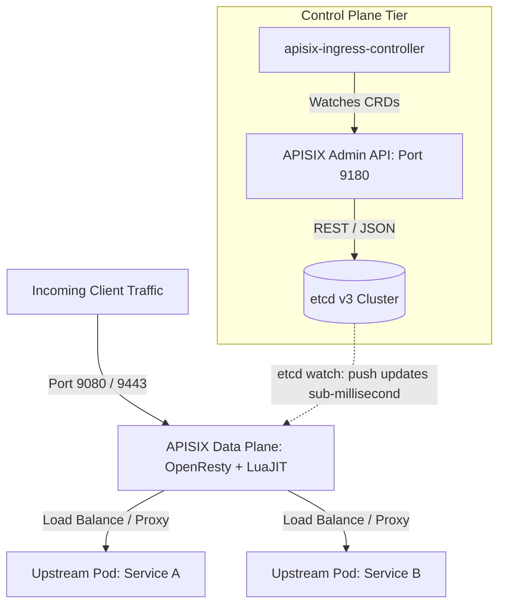

# Apache APISIX Internal Architecture

APISIX completely decouples the **Control Plane** (Admin API & etcd storage) from the **Data Plane** (OpenResty worker processes).

---

## 🏛️ Control Plane vs Data Plane Topology

---

## 🔄 The Entity Model: Route, Service, Upstream & Consumer

- **Route**: Matches client requests by HTTP method, host, URI path, headers, or query parameters. Directs traffic to an Upstream or Service.
- **Service**: Reusable abstraction grouping multiple routes that share identical plugins or upstream targets.
- **Upstream**: Defines target destination nodes (IPs, ports, weights), load balancing algorithms, and health check probes.
- **Consumer**: Represents authenticated API consumers (API keys, JWT subjects, OAuth clients).
- **Plugin**: Intercepts request/response lifecycle phases (rewrite, access, header_filter, body_filter, log).
