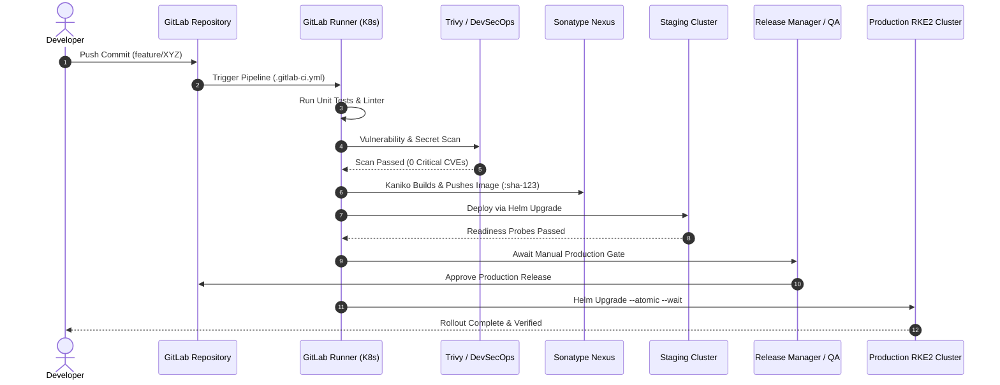

# DevOps Lifecycle & CI/CD Delivery Architecture

This document formalizes the engineering lifecycle from local developer commit through automated validation, container packaging, security scanning, artifact hosting, and zero-downtime production deployment.

---

## 🔄 End-to-End Delivery Pipeline Flow

---

## 🛠️ Pipeline Stages & Quality Gates

### Stage 1: Static Code Analysis & Unit Testing
- **Execution**: Runs in isolated Node.js, Go, or Python containers on GitLab Runners.
- **Criteria**: Code formatting, syntax analysis, unit tests with minimum 80% coverage threshold.
- **Fail Fast**: Terminates pipeline on first failing test to preserve runner compute.

### Stage 2: DevSecOps Vulnerability & Dependency Scanning
- **Container Scanning**: Aquasec Trivy scans base image layers and OS dependencies for known CVEs.
- **Secret Detection**: Scans git commit diffs for exposed credentials, certificates, or tokens.
- **Enforcement**: Any CVE with severity `CRITICAL` or `HIGH` having an available fix fails the build.

### Stage 3: Container Image Build & Publication
- **Daemonless Build**: Uses `gcr.io/kaniko-project/executor` inside Kubernetes pods, eliminating the need to mount the host Docker socket (`/var/run/docker.sock`).
- **Target Registry**: Pushes immutable tags (`:sha-xxxxxx` and semantic version tags) to the private Sonatype Nexus Docker registry.
- **Layer Caching**: Reusable intermediate build layers are cached in Nexus to speed up build cycles.

### Stage 4: Staging Deployment & Integration Testing
- **Helm Rollout**: Evaluates Helm templates and applies manifests to the staging namespace.
- **Automated Verification**: Endpoints are smoke-tested via automated curl and API regression suites.

### Stage 5: Production Deployment & Approval Gate
- **Human Approval**: Requires explicit approval from authorized release engineers in GitLab.
- **Atomic Rollout**: Executed with `--atomic` and `--timeout 8m` flags to automatically roll back to the previous stable revision if pods fail health checks.
