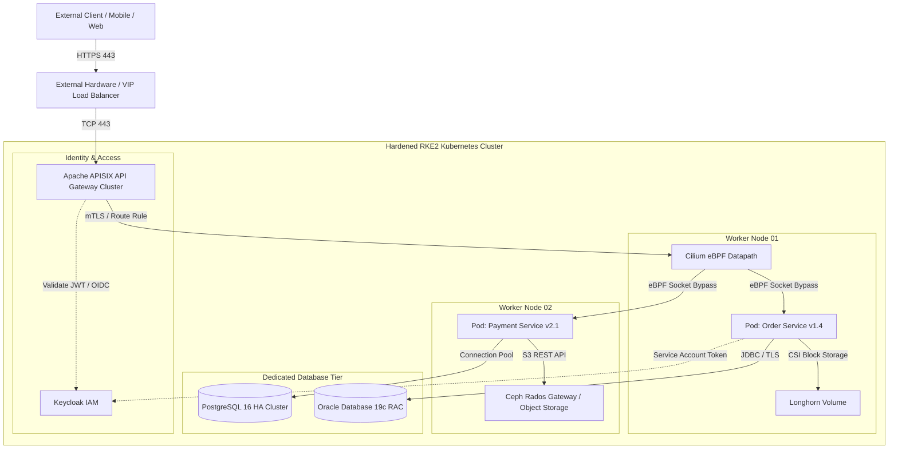

# Infrastructure & Platform Architecture Overview

This document describes the reference cloud-native infrastructure topology utilized across production environments, integrating **RKE2 Kubernetes**, **Cilium eBPF networking**, **Apache APISIX API Gateway**, **Sonatype Nexus**, **Ceph Storage**, and **Enterprise Identity Providers**.

---

## 🏛️ High-Level Request Path Architecture

The diagram below illustrates the end-to-end network request path from external consumers to internal microservices and backing persistent datastores:

---

## 🧩 Architectural Components & Responsibilities

### 1. Ingress & Traffic Management: Apache APISIX
- **Edge Security**: Terminates external TLS with automatic certificate synchronization.
- **Dynamic Routing**: Hot-reloads routes, upstreams, and rate-limiting rules via etcd without restarting Nginx worker processes.
- **Authentication Gateway**: Inspects incoming HTTP Authorization headers, validates JWT signatures against Keycloak public keys, and enforces role-based endpoint permissions.

### 2. Kubernetes Networking: Cilium eBPF
- **Kube-Proxy Replacement**: Routes traffic at the Linux kernel socket layer (`sockops`), bypassing iptables packet traversal overhead.
- **Zero-Trust Network Policies**: Enforces Layer 3 (IP/CIDR), Layer 4 (Port/Protocol), and Layer 7 (HTTP methods and URL paths) isolation.
- **Deep Visibility**: Cilium Hubble captures per-connection flow metrics, DNS resolution latency, and HTTP response codes directly from kernel probes.

### 3. Identity & Access: Keycloak & Enterprise AD
- **Single Sign-On (SSO)**: Implements OpenID Connect (OIDC) and OAuth 2.0 authorization code flows.
- **User Federation**: Syncs with enterprise Active Directory / LDAP over LDAPS via SSSD and Keycloak user federation providers.

### 4. Storage Architecture: Ceph RGW & Longhorn
- **Ceph Rados Gateway**: Provides multi-tenant, durable S3-compatible object storage for application file uploads, backups, and artifact archives.
- **Longhorn Distributed Block Storage**: Supplies low-latency ReadWriteOnce (RWO) CSI volumes for stateful database containers and monitoring datastores.

---

## 🔒 Security Segmentation Zones

1. **DMZ / Public Edge**: Only port 443 (HTTPS) is accessible through external firewalls into the APISIX ingress tier.
2. **Cluster Private Network**: Pod-to-Pod communication is encrypted and restricted via Cilium default-deny NetworkPolicies.
3. **Database Demilitarized Zone**: Oracle and PostgreSQL instances reside on isolated VLANs accessible only from designated worker node subnets over authenticated TLS ports.
