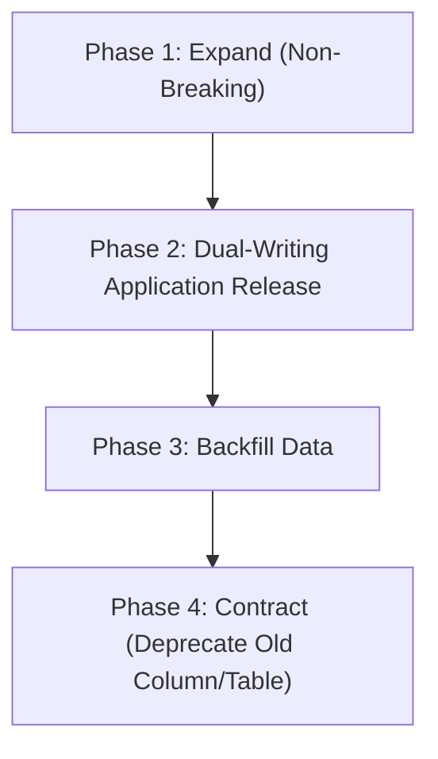

# Release Management & Deployment Strategies

This guide defines standard deployment methodologies, rollback triggers, change control policies, and database migration safety patterns used in enterprise production deployments.

---

## 🚀 Comparison of Deployment Strategies

| Strategy | Downtime | Resource Overhead | Rollback Speed | Complexity | Best For |
| :--- | :--- | :--- | :--- | :--- | :--- |
| **Rolling Update** | 0s | Low (+25% surge) | Moderate (minutes) | Low | Standard stateless APIs, default K8s workloads |
| **Canary** | 0s | Low | Fast (traffic shift) | Medium | High-volume critical APIs, new feature validation |
| **Blue/Green** | 0s | High (+100% duplicate) | Instant (router switch) | Medium | Major releases, complex database schemas |
| **Recreate** | Minutes | None | Slow | Low | Legacy apps that cannot run dual versions simultaneously |

---

## 🛡️ Database Migration Safety Guidelines

Stateful database schema changes represent the highest risk factor in modern continuous delivery. Always decouple database migrations from code rollouts using the **Expand-and-Contract** pattern:



### Strict Rules for Zero-Downtime Database Migrations:
1. **Never rename columns directly**: Add the new column, write to both, backfill legacy rows, read from new column, and finally drop the old column in a subsequent release.
2. **Never add non-nullable columns without a default**: Adding a `NOT NULL` column without a `DEFAULT` locks tables and breaks running application pods that insert data without the new field.
3. **Run migrations before application rollout**: Execute DDL statements in an isolated pre-deployment job (e.g., Kubernetes `pre-install` or `pre-upgrade` Helm hooks).

---

## ⏪ Automated Rollback Triggers

Workload deployments must automatically initiate rollback if any of the following conditions occur:

1. **Probe Failures**: Startup or readiness probe fails consecutively for 3 minutes.
2. **CrashLoopBackOff**: Any new replica crashes during initial initialization.
3. **Error Budget Burn Rate**: Production HTTP 5xx error rate spikes above 1% within the first 5 minutes of release.
4. **Latency Degradation**: p99 latency increases by more than 150% compared to the pre-release 1-hour baseline.

### Immediate Manual Rollback Commands
```bash
# [STATE-MODIFYING] Roll back Kubernetes deployment to previous revision
kubectl rollout undo deployment/<service-name> -n <namespace>

# [STATE-MODIFYING] Roll back Helm release to specific historical revision
helm rollback <release-name> <revision-number> -n <namespace>
```
