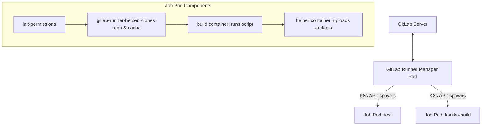

# GitLab Runners Architecture & Artifact Management

Operating enterprise GitLab Runners on Kubernetes, configuring auto-scaling worker pods, and managing build artifacts.

---

## 🏃 Kubernetes Runner Architecture

The Kubernetes executor dynamically spawns a build pod for each job and terminates it upon job completion:



---

## ⚙️ Runner `config.toml` Tuning

```toml
concurrent = 10
check_interval = 5

[[runners]]
  name = "k8s-runner-pool-01"
  url = "https://gitlab.example.com"
  executor = "kubernetes"
  [runners.kubernetes]
    namespace = "gitlab-runners"
    image = "alpine:3.19"
    privileged = false
    cpu_request = "500m"
    memory_request = "1Gi"
    cpu_limit = "4"
    memory_limit = "8Gi"
    poll_interval = 5
    poll_timeout = 360
    service_account = "gitlab-runner-sa"
    [runners.kubernetes.node_selector]
      "node-role.kubernetes.io/worker" = "true"
```
