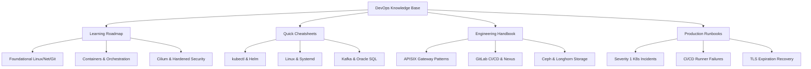

# DevOps Knowledge Base & Operations Handbook

Welcome to the **DevOps Knowledge Base & Operations Handbook**. This repository serves as a centralized, battle-tested operational guide, learning roadmap, and troubleshooting reference for platform engineers, DevOps practitioners, and site reliability engineers (SRE).

---

## 🎯 Repository Mission & Design

In modern hybrid-cloud and on-premise enterprise environments, operational tribal knowledge often ends up fragmented across chat channels, ticket histories, and disparate internal wikis. This repository brings together:

---

## 🧭 Navigating the Documentation

- **[Learning Roadmap](learning-roadmap.md)**: A 7-level progressive path from Linux fundamentals to advanced multi-cluster eBPF networking and site reliability.
- **[Architecture & Lifecycle](architecture/overview.md)**: The end-to-end SDLC pipeline, release engineering controls, and architectural topologies.
- **[Kubernetes & RKE2](kubernetes/index.md)**: Detailed cluster operations, scheduling, RBAC, Helm packaging, and the [Kubectl Cheatsheet](kubernetes/kubectl-cheatsheet.md).
- **[Cilium & eBPF Networking](kubernetes/cilium.md)**: Modern kernel-level packet routing, network policies, and Hubble observability.
- **[Apache APISIX API Gateway](apisix/index.md)**: Ingress routing, plugins, SSL/TLS termination, and token verification.
- **[GitLab CI/CD](cicd/index.md)** & **[Sonatype Nexus](nexus/index.md)**: High-throughput pipelines, runners, caching, and private container registries.
- **[Ansible Automation](ansible/index.md)** & **[Bash](automation/bash.md)**: Idempotent configuration management and shell tooling.
- **[Observability](observability/index.md)**: Prometheus alerts, Grafana dashboards, ELK stack log aggregation, and SLI/SLO calculations.
- **[Kafka & Streaming](kafka/index.md)**: Distributed messaging, Kafka Connect, consumer group lag diagnostics.
- **[Databases](databases/index.md)**: Oracle SQL, SQL*Plus diagnostics, PostgreSQL administration, and JDBC integrations.
- **[Security & IAM](security/index.md)**: Keycloak, OAuth2/OIDC, DevSecOps scanning, and TLS certificate rotation.
- **[Storage & Ceph](storage/index.md)**: Ceph object storage (RGW), S3 APIs, and Longhorn block storage.
- **[Incident Runbooks](runbooks/index.md)**: Step-by-step procedures for live production triage.

---

## ⚡ Conventions & Safety

Every command in this handbook is annotated with operational safety tags:
- `[READ-ONLY]`: Safe for immediate production execution; no side effects.
- `[STATE-MODIFYING]`: Changes configuration or workload states; requires confirmation.
- `[DESTRUCTIVE / HIGH-RISK]`: Potential downtime, traffic disruption, or data loss.

Refer to [Conventions](conventions.md) and [Glossary](glossary.md) for full formatting rules and terminology.
