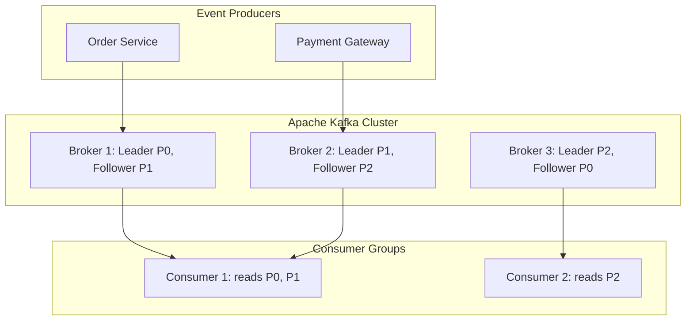

# Apache Kafka & Distributed Streaming Architecture

Apache Kafka is a horizontally scalable, fault-tolerant, high-throughput distributed event log platform.

---

## 📑 Chapter Contents

- **[Kafka Commands Cheatsheet](commands-cheatsheet.md)**: Topic creation, partition rebalancing, consumer group diagnostics, and offset inspection.
- **[Kafka Connect & CDC Pipelines](kafka-connect.md)**: Source and Sink connectors, Debezium change data capture, and JDBC connectors.
- **[Consumer Groups & Offset Lag](consumer-groups-and-offsets.md)**: Partition rebalance triggers, offset commit strategies, and lag diagnostics.
- **[Kafka Troubleshooting](troubleshooting.md)**: Broker out of sync replicas (ISR), partition leader election failures, and disk storage compaction.

---

## 🏛️ Kafka Core Architecture

