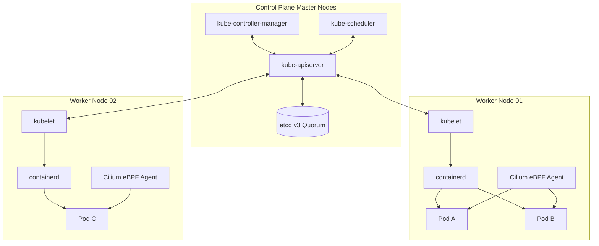

# Kubernetes Control Plane & Node Architecture

Kubernetes coordinates a distributed cluster of machines to execute containerized workloads with declarative state reconciliation.

---

## 🏛️ Control Plane & Node Topology

---

## ⚙️ Core Control Plane Components

1. **`kube-apiserver`**:
   - The central REST API gateway and state gatekeeper.
   - All components (controllers, scheduler, kubelet, kubectl) communicate exclusively with the API server.
   - Evaluates authentication (X.509 certs, OIDC tokens), authorization (RBAC), and admission controllers (validating/mutating webhooks).

2. **`etcd`**:
   - Highly available, strongly consistent distributed key-value store based on the Raft consensus algorithm.
   - Stores the complete declared and current state of all Kubernetes objects.
   - Recommended odd quorum count (3 or 5 members) to prevent split-brain scenarios.

3. **`kube-scheduler`**:
   - Assigns unassigned Pods to optimal worker nodes based on resource requests, taints and tolerations, node affinity/anti-affinity, and topology spread constraints.

4. **`kube-controller-manager`**:
   - Runs core reconciliation loops (DeploymentController, NodeLifecycleController, EndpointSliceController, ServiceAccountController) comparing declared desired state with actual cluster status.

---

## 🖥️ Worker Node Components

1. **`kubelet`**:
   - The primary node agent responsible for registering the node with the API server, ensuring pods described in `PodSpec` are created and healthy via CRI, and reporting node status.
2. **`containerd` (CRI)**:
   - High-performance container runtime executing containers, pulling image layers, and attaching cgroups and namespaces.
3. **`Cilium` (CNI)**:
   - Attaches eBPF programs to node network interfaces (`tc`, `sockops`), provisioning pod IPs and enforcing security policies directly inside the Linux kernel.
