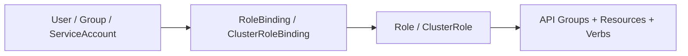

# Kubernetes Role-Based Access Control (RBAC)

Role-Based Access Control enforces the principle of least privilege, regulating access to Kubernetes API resources based on user and service identities.

---

## 🏛️ RBAC Entity Relationship



- **Role**: Namespaced set of permissions (e.g., read pods in `workloads`).
- **ClusterRole**: Cluster-wide set of permissions (e.g., list nodes, read all namespaces) or non-namespaced resources (StorageClasses, CRDs).
- **RoleBinding**: Grants permissions within a specific namespace.
- **ClusterRoleBinding**: Grants permissions across the entire cluster.

---

## 📝 Least-Privilege CI/CD Deployer ServiceAccount

Avoid granting `cluster-admin` to CI/CD pipelines. Create a scoped `Role` and `RoleBinding` limited to the target workload namespace:

```yaml
apiVersion: v1
kind: ServiceAccount
metadata:
  name: gitlab-ci-deployer
  namespace: workloads
---
apiVersion: rbac.authorization.k8s.io/v1
kind: Role
metadata:
  name: workload-manager
  namespace: workloads
rules:
  - apiGroups: ["apps"]
    resources: ["deployments", "statefulsets", "replicasets"]
    verbs: ["get", "list", "watch", "create", "update", "patch", "delete"]
  - apiGroups: [""]
    resources: ["services", "configmaps", "secrets", "pods"]
    verbs: ["get", "list", "watch", "create", "update", "patch", "delete"]
  - apiGroups: ["networking.k8s.io"]
    resources: ["ingresses", "networkpolicies"]
    verbs: ["get", "list", "watch", "create", "update", "patch"]
---
apiVersion: rbac.authorization.k8s.io/v1
kind: RoleBinding
metadata:
  name: gitlab-ci-deployer-binding
  namespace: workloads
subjects:
  - kind: ServiceAccount
    name: gitlab-ci-deployer
    namespace: workloads
roleRef:
  kind: Role
  name: workload-manager
  apiGroup: rbac.authorization.k8s.io
```

---

## 🔍 Auditing RBAC Permissions

```bash
# [READ-ONLY] Check effective permissions of the CI deployer
kubectl auth can-i create deployments -n workloads --as=system:serviceaccount:workloads:gitlab-ci-deployer

# [READ-ONLY] Audit which ServiceAccounts have cluster-admin privileges
kubectl get clusterrolebindings -o jsonpath='{range .items[?(@.roleRef.name=="cluster-admin")]}{.metadata.name}: {.subjects[*].name}{"\n"}{end}'
```
