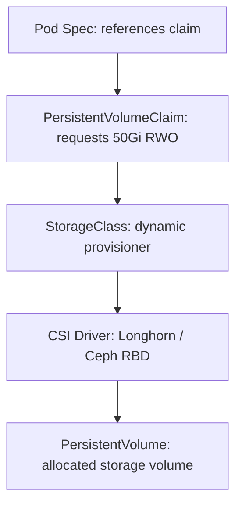

# Kubernetes Storage, CSI & Persistent Volumes

Kubernetes decouples storage infrastructure from application manifests through Container Storage Interface (CSI) drivers, StorageClasses, PersistentVolumes (PV), and PersistentVolumeClaims (PVC).

---

## 💾 Storage Architecture: PV, PVC & StorageClass



### 1. StorageClass Definition (Longhorn / Ceph RBD)
```yaml
apiVersion: storage.k8s.io/v1
kind: StorageClass
metadata:
  name: fast-nvme-sc
provisioner: driver.longhorn.io
allowVolumeExpansion: true
reclaimPolicy: Retain
volumeBindingMode: WaitForFirstConsumer
parameters:
  numberOfReplicas: "3"
  staleReplicaTimeout: "2880"
```
*Note*: `volumeBindingMode: WaitForFirstConsumer` ensures the volume is provisioned only on the node where the pod is actually scheduled, respecting topology and node affinity constraints.

### 2. PersistentVolumeClaim Example
```yaml
apiVersion: v1
kind: PersistentVolumeClaim
metadata:
  name: postgres-pvc
  namespace: workloads
spec:
  accessModes:
    - ReadWriteOnce
  storageClassName: fast-nvme-sc
  resources:
    requests:
      storage: 100Gi
```

---

## ⚡ Online Volume Expansion

When a PersistentVolume runs low on capacity:

```bash
# [STATE-MODIFYING] Edit PVC capacity to 200Gi
kubectl patch pvc postgres-pvc -n workloads -p '{"spec":{"resources":{"requests":{"storage":"200Gi"}}}}'

# [READ-ONLY] Verify storage controller and filesystem resize status
kubectl describe pvc postgres-pvc -n workloads
```
*CSI driver automatically expands the underlying block device and the filesystem without requiring pod restarts.*

---

## ⚠️ Troubleshooting Storage Failures

1. **PVC in `Pending` state**:
   - Check `kubectl describe pvc <name>`.
   - Often caused by insufficient node storage, missing StorageClass, or `WaitForFirstConsumer` awaiting pod scheduling.
2. **`VolumeSubpathInitializationFailed` / Multi-Attach errors**:
   - Occurs when a pod is rescheduled to a new node before the previous node detached the RWO volume.
   - Force detach via CSI controller or check the node's `/var/lib/kubelet/plugins/kubernetes.io/csi/` directory.
