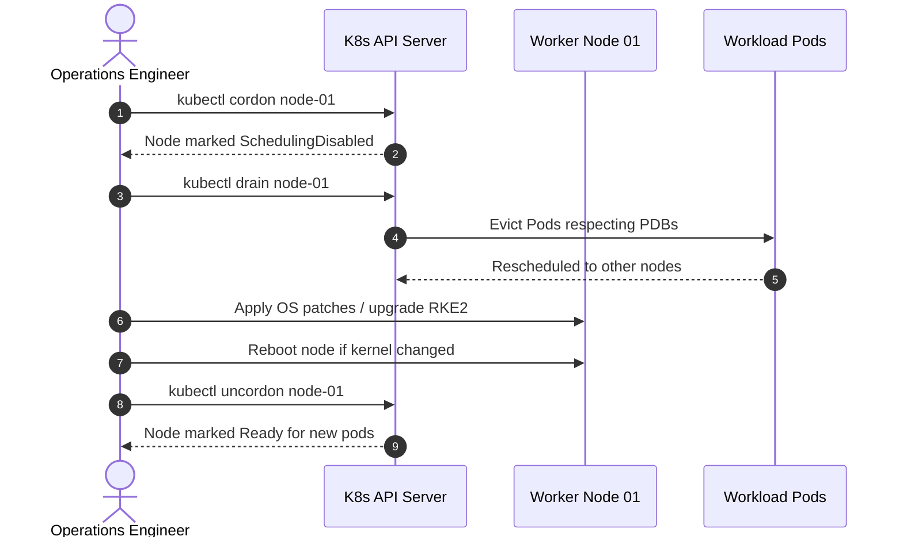

# Kubernetes Cluster Upgrades & Node Maintenance

Upgrading production Kubernetes clusters requires careful staging, sequential node draining, and validation to prevent downtime.

---

## 🛡️ Step-by-Step Node Eviction & Maintenance Procedure



### 1. Step 1: Cordon Node (Prevent New Scheduling)
```bash
# [STATE-MODIFYING] Mark node unschedulable
kubectl cordon <node-name>
```

### 2. Step 2: Drain Node (Evict Running Pods Safely)
```bash
# [HIGH-RISK] Evict workloads respecting PodDisruptionBudgets
kubectl drain <node-name> \
  --ignore-daemonsets \
  --delete-emptydir-data \
  --timeout=5m
```
*If a PodDisruptionBudget blocks eviction*: Check `kubectl get pdb -A` to determine which service cannot lose replicas.

### 3. Step 3: Upgrade RKE2 Version
```bash
# [STATE-MODIFYING] Install new RKE2 version binary (example: v1.30.2+rke2r1)
curl -sfL https://get.rke2.io | INSTALL_RKE2_VERSION=v1.30.2+rke2r1 sh -

# Restart service
sudo systemctl restart rke2-agent # (or rke2-server on control plane)
```

### 4. Step 4: Uncordon Node
```bash
# [STATE-MODIFYING] Re-enable pod scheduling onto node
kubectl uncordon <node-name>

# [READ-ONLY] Verify node is Ready with updated version
kubectl get node <node-name>
```
