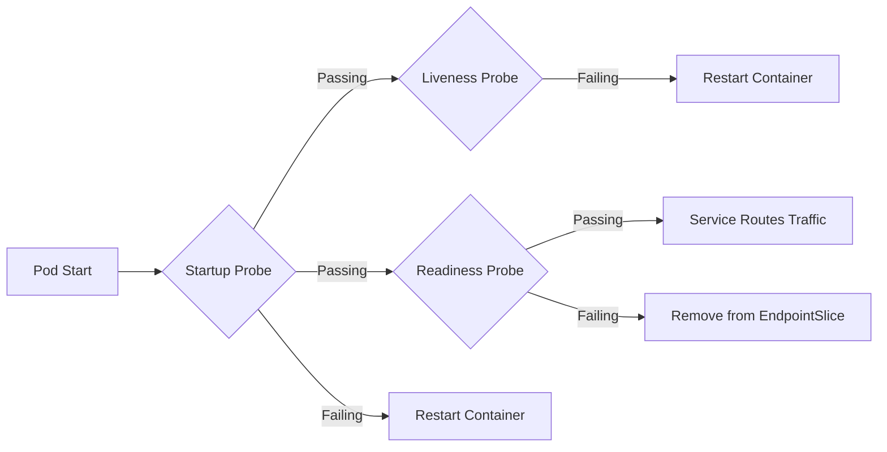

# Kubernetes Workloads & Service Discovery

Workloads represent running applications on Kubernetes, managed by controllers that enforce declared replica counts, health checks, and rolling update strategies.

---

## 📦 Workload Controllers Comparison

| Controller | Use Case | State | Replicas |
| :--- | :--- | :--- | :--- |
| **Deployment** | Stateless HTTP APIs, microservices, web workers | Stateless | Scaled arbitrarily (0..N) |
| **StatefulSet** | Databases (PostgreSQL, Kafka, ZooKeeper, Elasticsearch) | Stateful | Unique persistent identity (`pod-0`, `pod-1`), ordered scale-up/down |
| **DaemonSet** | Node agents (Cilium, Promtail, Node Exporter, Fluent Bit) | Host-bound | Exactly 1 pod per eligible cluster node |
| **Job / CronJob** | Database migrations, batch processing, backups | Ephemeral | Executes to completion, runs on schedule |

---

## 🚦 Health Probes: Startup, Liveness & Readiness

Misconfigured probes are the leading cause of premature pod restarts and cascading outages in production.



### Probe Configuration Guidelines:
1. **Startup Probe**: Use when applications take >15 seconds to initialize (e.g., JVM warmups, cache preloading). Prevents liveness probe from prematurely killing slow-starting containers.
2. **Liveness Probe**: Detects deadlocks and hung processes. If it fails, kubelet kills and restarts the container.
3. **Readiness Probe**: Detects whether the pod is ready to accept external traffic. If it fails, the pod is temporarily removed from Service EndpointSlices without restarting.

```yaml
startupProbe:
  httpGet:
    path: /healthz
    port: 8080
  failureThreshold: 30
  periodSeconds: 10
livenessProbe:
  httpGet:
    path: /healthz
    port: 8080
  periodSeconds: 15
  timeoutSeconds: 3
  failureThreshold: 3
readinessProbe:
  httpGet:
    path: /ready
    port: 8080
  periodSeconds: 5
  timeoutSeconds: 2
  failureThreshold: 2
```

---

## 🖧 Service Types & Service Discovery

- **ClusterIP** (Default): Internal virtual IP accessible only within the cluster.
- **NodePort**: Allocates a static port (30000-32767) on every node's external IP.
- **LoadBalancer**: Provisions an external hardware or cloud load balancer forwarding to NodePort.
- **Headless (`clusterIP: None`)**: Returns DNS SRV records resolving directly to individual Pod IPs (required for StatefulSets like Kafka and Cassandra).
