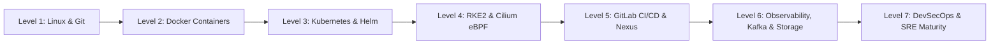

# Progressive DevOps Learning Roadmap

This roadmap outlines a structured, 7-level journey from foundational operating system principles to advanced site reliability engineering, hardened cluster orchestration, and automated release governance.

---

## 🟢 Level 1: Linux, Networking, Git, Bash & YAML

### 1. Learning Objectives
- Master the Linux command line, process hierarchy, signals, and memory management.
- Understand IP routing, TCP/UDP sockets, DNS resolution, and systemd units.
- Acquire Git fluency: interactive rebasing, merge conflict resolution, and hygiene.
- Write robust, idempotent Bash scripts with `set -euo pipefail` and clean YAML.

### 2. Prerequisites
- Access to an Ubuntu or Debian server terminal.

### 3. Relevant Repository Pages
- [Linux Commands Cheatsheet](linux/commands-cheatsheet.md)
- [Linux Networking & DNS](linux/networking.md)
- [Systemd Service Management](linux/systemd.md)
- [Git Commands Cheatsheet](git/commands-cheatsheet.md)
- [Bash Automation Guide](automation/bash.md)
- [YAML Standards](automation/yaml.md)

### 4. Practical Hands-on Exercises
1. Inspect active listening ports with `ss -tulpn` and map PID to service unit via `systemctl status <PID>`.
2. Write a systemd timer unit (`backup.timer` + `backup.service`) that executes a Bash backup script daily at 02:00 UTC.
3. Diagnose a failing DNS resolution using `dig +trace example.com` and `resolvectl status`.
4. Create a Git repository, make 3 commits, and use `git rebase -i HEAD~3` to squash them into a single clean commit with a descriptive body.

### 5. Definition of Done
- Able to diagnose high CPU/memory/IO wait issues using `top`, `vmstat`, `iostat`, and `ss`.
- Able to configure and troubleshoot Linux systemd services and socket units independently.

---

## 🟡 Level 2: Docker & Container Runtime Fundamentals

### 1. Learning Objectives
- Understand Linux cgroups, namespaces (PID, net, mnt, user), and union filesystems (overlay2).
- Craft minimal, multi-stage Dockerfiles utilizing distroless or Alpine base images.
- Master Docker Compose for multi-container development and integration stacks.
- Secure container runtimes: drop Linux capabilities, run as non-root, mount read-only filesystems.

### 2. Relevant Repository Pages
- [Docker Commands Cheatsheet](docker/commands-cheatsheet.md)
- [Docker Compose Guide](docker/docker-compose.md)
- [Container Networking](docker/networking.md)
- [Container Image Optimization & Security](docker/image-management.md)

### 3. Practical Hands-on Exercises
1. Build a multi-stage Dockerfile for a Go or Node.js application, reducing the final image size below 50MB.
2. Launch a 3-tier application (Nginx reverse proxy, API backend, PostgreSQL database) with custom user-defined bridge networks and named persistent volumes.
3. Inspect a container's isolated network namespace with `nsenter` and inspect its veth pair using `ip link`.

### 4. Definition of Done
- Container images scan cleanly with 0 Critical or High CVEs in Trivy.
- Containers run with `read_only: true` and non-root UID.

---

## 🟠 Level 3: Kubernetes & Helm Packaging

### 1. Learning Objectives
- Internalize the Kubernetes control plane architecture (API Server, etcd, Controller Manager, Scheduler).
- Understand Pod lifecycle, ReplicaSets, Deployments, StatefulSets, and DaemonSets.
- Configure Services (ClusterIP, NodePort, LoadBalancer) and CoreDNS name resolution.
- Manage configuration decoupled from code via ConfigMaps and Secrets.
- Package and version complex application stacks using Helm 3.

### 2. Relevant Repository Pages
- [Kubernetes Architecture](kubernetes/architecture.md)
- [Kubectl Cheatsheet](kubernetes/kubectl-cheatsheet.md)
- [Workloads & Services](kubernetes/workloads-and-services.md)
- [Configuration & Secrets](kubernetes/configuration-and-secrets.md)
- [Helm Packaging & Releases](kubernetes/helm.md)

### 3. Practical Hands-on Exercises
1. Deploy a resilient 3-replica workload with startup, liveness, and readiness probes and resource requests/limits.
2. Author a customized Helm chart with `values.schema.json` validation, conditional templates, and helper templates (`_helpers.tpl`).
3. Perform a zero-downtime rolling update, inspect rollout history, and practice `kubectl rollout undo`.

---

## 🔵 Level 4: RKE2, Cilium & Production Networking

### 1. Learning Objectives
- Operate hardened Kubernetes using RKE2 (Rancher Government / Rancher Kubernetes Engine 2).
- Replace kube-proxy with Cilium eBPF for host-routing, kube-proxy replacement, and BPF maps.
- Implement fine-grained Layer 3, Layer 4, and Layer 7 Cilium Network Policies (CNP).
- Leverage Cilium Hubble for real-time packet-level network flow observability and TLS inspection.

### 2. Relevant Repository Pages
- [RKE2 Cluster Administration](kubernetes/rke2.md)
- [Cilium eBPF Networking & Hubble](kubernetes/cilium.md)
- [Kubernetes RBAC & Service Accounts](kubernetes/rbac.md)
- [Cluster Upgrades & Maintenance](kubernetes/upgrades-and-maintenance.md)

### 3. Practical Hands-on Exercises
1. Spin up a multi-node RKE2 cluster with external datastore and CIS 1.23 benchmark profile.
2. Enable Cilium with `kubeProxyReplacement=true`, inspect eBPF maps with `cilium bpf lb list`.
3. Write a `CiliumNetworkPolicy` that restricts database access exclusively to pods with label `role: backend` on port 5432 and blocks all egress except CoreDNS.
4. Visualize network drops and policy denials using `hubble observe --verdict DROPPED`.

---

## 🟣 Level 5: GitLab CI/CD, Nexus & Release Engineering

### 1. Learning Objectives
- Architect multi-stage, resilient GitLab CI/CD pipelines with artifact passing and cache caching.
- Build container images securely inside Kubernetes clusters using daemonless Kaniko.
- Configure Sonatype Nexus Repository Manager for Docker registries and package proxies (npm, PyPI, Maven).
- Implement automated testing, security gates, staging promotions, and manual production approvals.

### 2. Relevant Repository Pages
- [GitLab CI Fundamentals](cicd/gitlab-ci-fundamentals.md)
- [Pipeline Architecture & Examples](cicd/pipeline-examples.md)
- [Runners & Artifact Management](cicd/runners-and-artifacts.md)
- [Nexus Repository Types & Configuration](nexus/repository-types.md)
- [Nexus Private Docker Registries](nexus/docker-registries.md)
- [Deployment & Rollback Strategies](cicd/deployment-strategies.md)

### 3. Practical Hands-on Exercises
1. Deploy a private GitLab Runner on Kubernetes using the official Helm chart.
2. Configure a pipeline that builds an image using Kaniko, pushes to a private Nexus registry, and runs Trivy vulnerability scanning.
3. Set up an atomic Helm deployment job with automatic rollback on failure (`--atomic --timeout 5m`).

---

## 🟤 Level 6: Observability, Kafka, Storage & Databases

### 1. Learning Objectives
- Deploy and configure Prometheus scrape targets, Alertmanager routing, and Grafana dashboards.
- Centralize container logs using the ELK Stack (Elasticsearch, Logstash, Kibana) or Fluent Bit.
- Diagnose Apache Kafka consumer lag, partition distribution, and Kafka Connect JDBC pipelines.
- Administer PostgreSQL and Oracle databases: queries, indexes, connection pools, and locks.
- Implement reliable Ceph distributed object storage (RGW/S3) and Longhorn persistent volumes.

### 2. Relevant Repository Pages
- [Prometheus Monitoring](observability/prometheus.md)
- [Grafana Visualizations](observability/grafana.md)
- [ELK Log Aggregation](observability/elk-stack.md)
- [Kafka Administration & Cheatsheet](kafka/commands-cheatsheet.md)
- [Kafka Consumer Lag & Offsets](kafka/consumer-groups-and-offsets.md)
- [Oracle SQL & SQL*Plus Guide](databases/oracle-sql-cheatsheet.md)
- [PostgreSQL Administration](databases/postgresql.md)
- [Ceph Architecture & Operations](storage/ceph.md)

### 3. Practical Hands-on Exercises
1. Write a PromQL alert rule for `KubePodCrashLooping` and `HighMemoryUtilization` (>85% for 10m).
2. Query Kafka topic consumer offsets via `kafka-consumer-groups.sh` to pinpoint stalled consumer threads.
3. Diagnose database connection pool exhaustion using `pg_stat_activity` and `v$session` in Oracle.

---

## 🔴 Level 7: DevSecOps, SRE Maturity & Production Readiness

### 1. Learning Objectives
- Formulate precise Service Level Indicators (SLI), Service Level Objectives (SLO), and Error Budgets.
- Manage identity federations using Keycloak, OAuth 2.0, and OpenID Connect (OIDC).
- Automate TLS certificate lifecycles using Cert-Manager and Let's Encrypt / Internal CA.
- Establish incident response workflows, severity triage, root cause analysis (RCA), and blameless postmortems.

### 2. Relevant Repository Pages
- [SLI, SLO & Error Budgets](observability/sli-slo-sla.md)
- [DevSecOps Framework](security/devsecops.md)
- [Keycloak & OIDC Integration](security/keycloak.md)
- [TLS & Certificate Management](security/tls-and-certificates.md)
- [Incident Response Framework](operations/incident-response.md)
- [Production Readiness Checklist](operations/production-readiness.md)
- [Kubernetes Incident Runbook](runbooks/kubernetes-incident.md)

### 3. Definition of Done
- Workloads conform to zero-trust network policies, non-root execution, and automated vulnerability scanning.
- Services have documented SLOs, active alert routing, and battle-tested incident runbooks.
