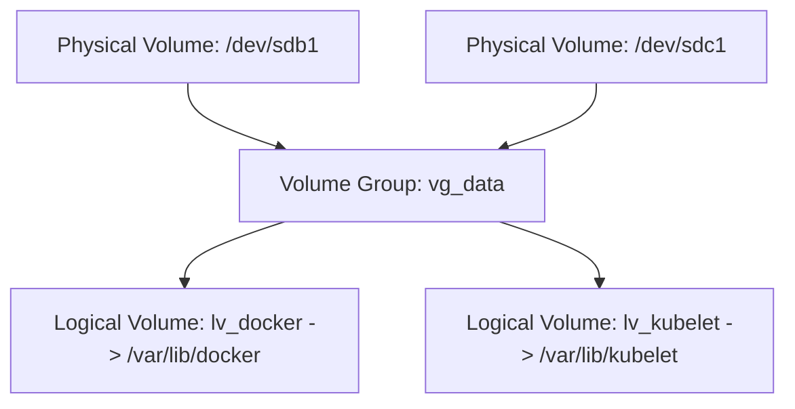

# Linux Storage, Filesystems & LVM Management

Production storage administration requires managing block devices, Logical Volume Management (LVM), filesystem maintenance, and I/O performance profiling.

---

## 🗄️ Block Device & Disk Inspection

```bash
# [READ-ONLY] Tree view of all block devices, mountpoints, UUIDs, and sizes
lsblk -f

# [READ-ONLY] View partition tables and sector alignments
sudo fdisk -l /dev/nvme0n1
```

---

## 📦 Logical Volume Management (LVM) Workflow

LVM abstracts physical storage into flexible pools that can be dynamically expanded without service downtime.



### 1. Create Physical Volumes (PV) and Volume Group (VG)
```bash
# [STATE-MODIFYING] Initialize physical volumes
sudo pvcreate /dev/sdb1 /dev/sdc1

# [STATE-MODIFYING] Create volume group named 'vg_data'
sudo vgcreate vg_data /dev/sdb1 /dev/sdc1

# [READ-ONLY] Inspect volume group status and free extents
sudo vgdisplay vg_data
```

### 2. Create and Format Logical Volume (LV)
```bash
# [STATE-MODIFYING] Create 100GB logical volume for container storage
sudo lvcreate -L 100G -n lv_containerd vg_data

# [STATE-MODIFYING] Format with ext4 or XFS filesystem
sudo mkfs.ext4 -L "CONTAINERD" /dev/vg_data/lv_containerd
```

### 3. Expand Logical Volume Online (Zero Downtime)
```bash
# [STATE-MODIFYING] Extend logical volume by 50GB and resize filesystem in one command
# For ext4:
sudo lvextend -L +50G -r /dev/vg_data/lv_containerd

# For XFS:
sudo lvextend -L +50G /dev/vg_data/lv_containerd
sudo xfs_growfs /var/lib/containerd
```

---

## ⚠️ Inode Exhaustion Triage

When a filesystem displays `No space left on device` but `df -h` shows plenty of free capacity:

```bash
# [READ-ONLY] Check inode utilization
df -i

# [READ-ONLY] Locate directory with the largest number of small files
find /var/spool -xdev -printf '%h\n' | sort | uniq -c | sort -k 1 -n | tail -n 20
```

---

## ⚡ Measuring Disk I/O Performance with `fio`

Never guess disk capability. Benchmark real random 4K write IOPS (standard database workload) using `fio`:

```bash
# [STATE-MODIFYING] Run non-destructive 4K random read/write IOPS benchmark
fio --name=randwrite --ioengine=libaio --iodepth=32 --rw=randwrite \
  --bs=4k --direct=1 --size=1G --numjobs=4 --runtime=30 --group_reporting \
  --filename=/var/tmp/fio_test_file

# Cleanup test file
rm -f /var/tmp/fio_test_file
```
Look for:
- `iops`: Target minimum 5,000 IOPS for enterprise SSDs; 50,000+ for NVMe.
- `lat (usec / msec)`: Target < 1.0ms latency for 99th percentile.
