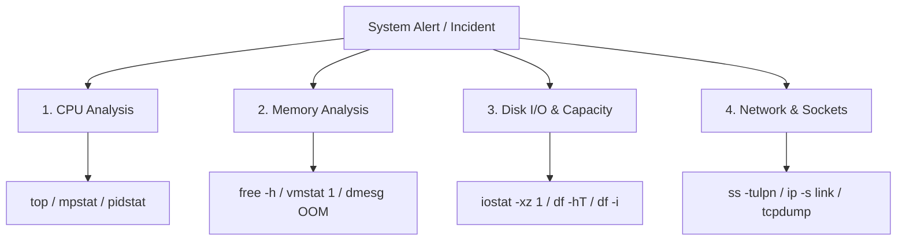

# Linux Systematic Troubleshooting Methodology

When responding to live server incidents, avoid speculative changes. Follow the structured **USE (Utilization, Saturation, Errors)** methodology:



---

## ⚡ Step 1: CPU Saturation & Run-Queue Bottlenecks

1. Check system load averages relative to physical CPU core count:
   ```bash
   # [READ-ONLY] View CPU core count and 1, 5, 15 min load averages
   nproc
   uptime
   ```
   *Rule of thumb*: If 1-minute load average is significantly higher than `nproc`, the CPU scheduler run-queue is saturated.

2. Identify whether CPU time is spent in User space, System (kernel), or IO Wait:
   ```bash
   # [READ-ONLY] Detailed CPU utilization breakdown every 1 second
   mpstat -P ALL 1 3
   ```
   - `%usr`: Application code computation (e.g., intensive Java or Node processing).
   - `%sys`: Kernel syscall overhead (e.g., heavy network context switches or memory paging).
   - `%iowait`: CPU is idle while waiting for disk operations to complete.

3. Pinpoint specific threads consuming CPU:
   ```bash
   # [READ-ONLY] Display per-thread CPU utilization for a specific process
   pidstat -t -p <PID> 1 3
   ```

---

## 🧠 Step 2: Memory Starvation & Swap Trashing

1. Inspect overall memory and swap state:
   ```bash
   # [READ-ONLY] Human-readable memory metrics
   free -h -w
   ```
   *Look at `available` (not `free`). Linux uses unused memory for PageCache (`buff/cache`).*

2. Detect active swapping and memory page churn:
   ```bash
   # [READ-ONLY] Report swap-in (si) and swap-out (so) rates every second
   vmstat 1 5
   ```
   *Critical threshold*: Non-zero values continuously in `si` or `so` indicate the host is actively thrashing swap space, degrading latency by 100x+.

---

## 💾 Step 3: Disk Saturation & Latency Spikes

1. Verify device latency and queue utilization:
   ```bash
   # [READ-ONLY] Device wait times and utilization percentage
   iostat -xz 1 5
   ```
   - `%util >= 90%`: Disk saturation.
   - `await > 15ms`: Slow disk I/O requests for SSDs; indicates storage bottleneck.

2. Identify processes generating excessive disk writes:
   ```bash
   # [READ-ONLY] Real-time per-process I/O tracker (requires root)
   sudo iotop -b -o -n 3
   ```

---

## 🌐 Step 4: Network Errors & Dropped Frames

1. Check interface statistics for dropped or over-run packets:
   ```bash
   # [READ-ONLY] Network interface packet drop counters
   ip -s link show
   ```

2. Check for TCP backlog queue overflows:
   ```bash
   # [READ-ONLY] TCP listen overflow and socket buffer errors
   netstat -s | grep -E "listen|overflow|drop"
   ```
