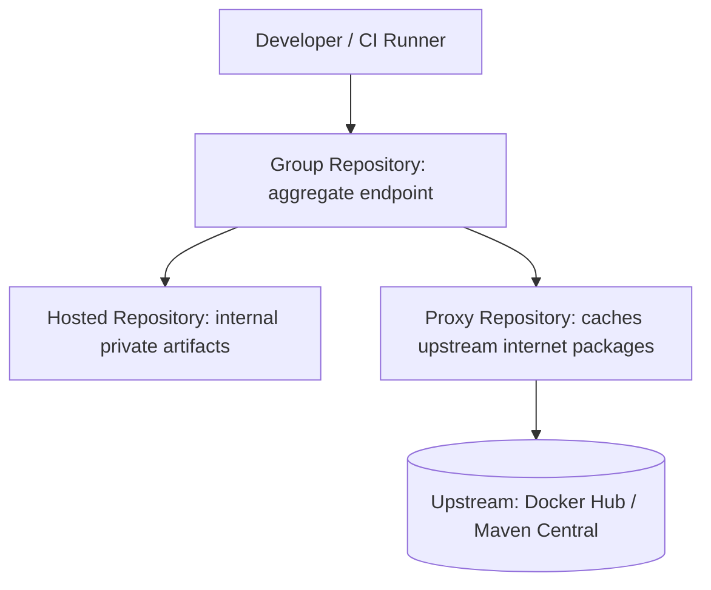

# Sonatype Nexus Repository Manager Architecture

Sonatype Nexus is the enterprise artifact repository manager used to cache upstream packages, store private build binaries, and host internal Docker container registries.

---

## 📑 Chapter Contents

- **[Repository Types & Topology](repository-types.md)**: Hosted, Proxy, and Group repositories explained.
- **[Private Docker Registries](docker-registries.md)**: Setting up Docker connectors (HTTP/HTTPS ports), Kubernetes pull secrets, and token authentication.
- **[Package Proxying & Air-Gapped Environments](package-proxying.md)**: Proxying Maven Central, npmjs, and PyPI with offline cache retention.
- **[Nexus Troubleshooting](troubleshooting.md)**: Disk storage blob exhaustion, container pull 401/403 errors, and corrupt Lucene search index rebuilding.

---

## 🎯 Architecture & Tri-Fold Model

Nexus organizes all package formats (Docker, Maven, npm, PyPI, Helm, Raw) into three foundational types:

