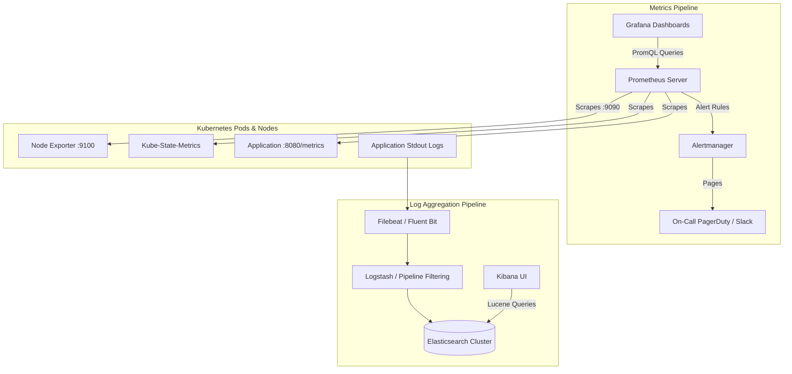

# Cloud-Native Observability & Reliability Engineering

Observability provides actionable visibility into distributed systems through the **Three Pillars of Observability**: Metrics (Prometheus), Visualizations & Dashboards (Grafana), and Centralized Logs (ELK Stack).

---

## 📑 Chapter Contents

- **[Prometheus Architecture & PromQL](prometheus.md)**: Scrape configs, metrics types (Counter, Gauge, Histogram, Summary), and production query recipes.
- **[Grafana Visualizations & Dashboards](grafana.md)**: Panel types, variables, templating, and dashboard JSON provisioning.
- **[ELK Stack Log Aggregation](elk-stack.md)**: Elasticsearch cluster health, Logstash pipelines, Filebeat shipping, and Kibana search syntax.
- **[SLI, SLO, SLA & Error Budgets](sli-slo-sla.md)**: Formulating quantitative reliability objectives and error budget burn rate alerting.
- **[Alerting & Troubleshooting](alerting-and-troubleshooting.md)**: Alertmanager routing, deduplication, inhibiting rules, and alert fatigue mitigation.

---

## 🏛️ Unified Observability Pipeline

