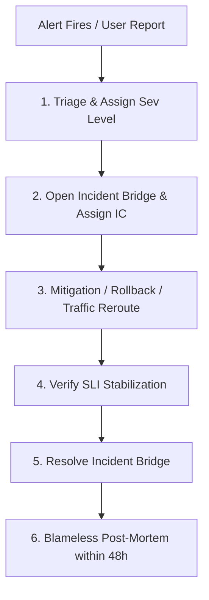

# Incident Response & Severity Triage Framework

A structured protocol for managing live production incidents, assigning severity levels, coordinating response roles, and conducting blameless post-mortems.

---

## 🚨 Incident Severity Matrix

| Severity | Impact | Customer Impact | Target Triage Time | Incident Commander |
| :--- | :--- | :--- | :--- | :--- |
| **SEV-1 (Critical)** | Core service down, catastrophic data loss, major security breach | > 25% of users impacted; financial transactions blocked | Immediate (< 5 min) | Principal SRE / Head of Infra |
| **SEV-2 (Major)** | Core service degraded with no workaround; redundancy lost | 5% - 25% of users impacted; latency elevated | < 15 min | Senior On-Call Engineer |
| **SEV-3 (Moderate)** | Non-critical service degraded; workaround available | Internal or minimal customer impact | < 1 hour | Secondary On-Call Engineer |
| **SEV-4 (Minor)** | Minor cosmetic defect, minor documentation or alerting bug | Zero customer impact | Next business day | Assigned during standup |

---

## 👥 Incident Response Roles

- **Incident Commander (IC)**: Holds single-threaded authority. Directs communication, assigns investigation tasks, and decides on rollback or failover actions. Does NOT write code or execute commands directly.
- **Operations Lead**: Executes CLI diagnostics, applies changes, and reports findings directly to the IC.
- **Communications Lead**: Updates customer status pages and internal executive stakeholders every 20-30 minutes with factual updates.

---

## 🔄 Incident Lifecycle Flowchart

