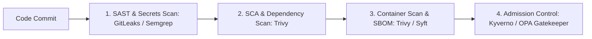

# DevSecOps: Automated Security in the Delivery Pipeline

DevSecOps integrates security gates, vulnerability scanning, and license compliance into continuous integration pipelines before code reaches production.

---

## 🛡️ DevSecOps Shift-Left Architecture



---

## 🔍 Tooling Reference & CLI Verification

### 1. Secret Scanning in Git Repositories (Gitleaks)
```bash
# [READ-ONLY] Scan repository history for committed API tokens or private keys
gitleaks detect --verbose --redact
```

### 2. Container Filesystem Scan (Trivy)
```bash
# [READ-ONLY] Fail build if Critical vulnerabilities exist with available fix
trivy image --exit-code 1 --severity CRITICAL --ignore-unfixed registry.example.com/app:1.2.0
```
