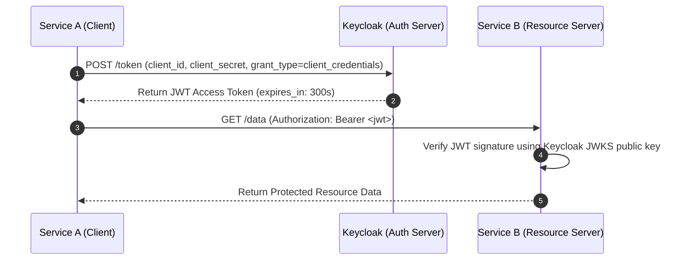

# OAuth 2.0 & OpenID Connect (OIDC) Architecture

OAuth 2.0 is an authorization framework allowing applications to obtain limited access to user accounts. OpenID Connect (OIDC) is an identity layer on top of OAuth 2.0 providing authentication.

---

## 🔑 Common Grant Types

| Grant Type | Intended Client | Use Case |
| :--- | :--- | :--- |
| **Authorization Code with PKCE** | Public clients (SPA, Mobile) & Confidential web apps | End-user single sign-on (SSO) login flow |
| **Client Credentials** | Machine-to-machine (M2M) confidential services | Microservice-to-microservice background API authentication |
| **Refresh Token** | Confidential clients | Exchanging long-lived refresh token for new short-lived access token |

---

## ⚡ Machine-to-Machine (Client Credentials) Flow



Testing via `curl`:
```bash
# [READ-ONLY] Fetch M2M Access Token
curl -s -X POST "https://keycloak.example.com/realms/corp/protocol/openid-connect/token" \
  -H "Content-Type: application/x-www-form-urlencoded" \
  -d "grant_type=client_credentials" \
  -d "client_id=service-a" \
  -d "client_secret=<secret>" | jq -r .access_token
```
