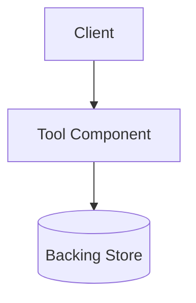

# [Tool Name]: Architecture & Operational Guide

A comprehensive technical reference for [Tool Name] covering its purpose, architecture, configuration standards, and administration.

---

## 1. Overview & Purpose
[Concise summary of what the tool does, problem solved, and where it fits in the architecture.]

---

## 2. Key Concepts & Terminology
- **Term 1**: Definition.
- **Term 2**: Definition.

---

## 3. Architecture & Execution Model


---

## 4. Prerequisites & Requirements
- Operating System / Kernel requirements.
- Network firewall rules / required listening ports.

---

## 5. Production Configuration Standards
```yaml
# Example production-grade configuration
```

---

## 6. Common Operations & Commands
```bash
# [READ-ONLY] Inspection command
# [STATE-MODIFYING] Maintenance command
```

---

## 7. Troubleshooting & Common Errors
| Error Symptom | Cause | Resolution |
| :--- | :--- | :--- |
| `Error XYZ` | Root cause | Fix procedure |

---

## 8. Security Considerations & Best Practices
- Non-root execution.
- Network isolation.
- Least-privilege permissions.

---

## 9. References & Upstream Documentation
- [Official Documentation](https://example.com)
